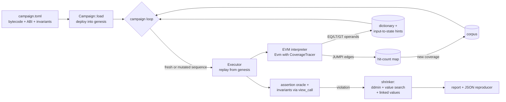

# evmfuzz

A Shanghai-level EVM interpreter written from scratch in Rust, and a
coverage-guided, stateful invariant fuzzer built on top of it. You declare
properties such as *"totalSupply equals the sum of all balances"*; evmfuzz
searches for a sequence of transactions that breaks one, then shrinks it to a
minimal reproducer.

[](https://github.com/SlateGitOrg/evmfuzz/actions/workflows/ci.yml)

```text
  BROKEN  payout-capped  after 2,658 tx / 509 sequences (7.8 ms)
    property: Staged.paidOut() <= Staged.cap()
    failure:  lhs = 120, rhs = 100 (expected lhs <= rhs)
    shrunk 10 -> 5 call(s) in 71 executions:
      1. actor0 -> Staged.unlock1(42)  => ok (gas 43829)
      2. actor0 -> Staged.unlock2(1001)  => ok (gas 26651)
      3. actor0 -> Staged.unlock3()  => ok (gas 26538)
      4. actor0 -> Staged.payout()  => ok (gas 47668)
      5. actor0 -> Staged.payout()  => ok (gas 30568)
```

*(From `make demo`. The `staged` fixture only pays out after `unlock1(42)`,
`unlock2(y)` with 1000 < y < 1010, and `unlock3()` from the same sender.)*

## Why

Smart-contract bugs are rarely a single bad call. They are usually an ordering
problem: deposit, then withdraw through a second path, then exit early. Unit
tests check the orderings someone thought of; a stateful invariant fuzzer
checks the ones nobody did. evmfuzz runs that loop against compiled bytecode
with no node, no chain fork and no framework, so a property test is a TOML
file and a single binary. Because the interpreter is in-tree, the fuzzer can
see every branch and comparison the contract executes and use them to steer
its inputs.

## Features

- **EVM interpreter (Shanghai)**: every Shanghai opcode including `PUSH0`;
  memory-expansion gas, EIP-2929 warm/cold access, EIP-2200/3529 `SSTORE`
  refunds, the 63/64 call-gas rule and EIP-3860 initcode metering; journaled
  state with O(changes) reverts; nested `CALL`/`CALLCODE`/`DELEGATECALL`/
  `STATICCALL`/`CREATE`/`CREATE2`; logs, `REVERT`, `SELFDESTRUCT`; transaction
  validation, EIP-1559 fees, refunds and EIP-161 cleanup; precompiles 0x02–0x04
  plus the input checks of 0x01.
- **Checked against `ethereum/tests`**: a runner for GeneralStateTests compares
  the Merkle-Patricia state root and logs hash of every case; 2,347 pinned cases
  pass, 0 fail.
- **Stateful invariant fuzzing**: campaigns deploy one or more contracts, then
  fuzz sequences of calls from several actors. Invariants are expressions over
  view calls, balances, storage slots and `sum`/`all`/`any` over address sets.
  A built-in assertion oracle flags `Panic(0x01)` and `INVALID`.
- **Coverage and value feedback**: AFL-style hit-count map over `JUMPI`
  directions, a dictionary of bytecode constants and runtime comparison
  operands (with ±1 neighbours), and per-argument input-to-state hints.
- **Sequence shrinking**: truncation, ddmin chunk removal, per-call value
  minimisation, and linked passes that move equal values and equal senders
  together.
- **Reproducible results**: the budget is counted in transactions, so
  `(campaign, seed, budget)` gives the same findings on any machine. Findings
  are saved as JSON reproducers that `replay` re-checks.
- **Built-in evaluation**: an ablation harness (`eval`) and throughput
  benchmarks (`bench`).
- **No external EVM crate**: own U256, Keccak-256, RLP and Merkle-Patricia
  trie; only the SHA-256 and RIPEMD-160 precompiles use RustCrypto crates.

## Architecture



Every sequence starts from the same genesis state. After each transaction the
executor folds branch coverage into the hit-count map, records comparison
operands, checks the assertion oracle and, if the transaction succeeded,
evaluates the invariants with read-only calls that are rolled back afterwards.
Sequences that reach new coverage are kept in the corpus and mutated further.

The interpreter is generic over a `Tracer`: `Evm<NoopTracer>` compiles the
hooks away for conformance runs and benchmarks, while `Evm<CoverageTracer>`
sees every `JUMPI` and comparison. Algorithms and their complexity are in
[`docs/ARCHITECTURE.md`](docs/ARCHITECTURE.md).

| module | what it does |
|---|---|
| `src/u256.rs`, `src/crypto.rs`, `src/rlp.rs`, `src/trie.rs` | 256-bit EVM arithmetic, in-tree Keccak-256, RLP, Merkle-Patricia state root |
| `src/evm/` | interpreter, gas, memory, stack, journaled state, transactions, precompiles, jump analysis, tracer trait |
| `src/statetest.rs` | runner for `ethereum/tests` GeneralStateTests (state root + logs hash) |
| `src/abi.rs` | Solidity ABI: types, selectors, head/tail encoding, JSON ABI loading, revert decoding |
| `src/fuzz/` | campaign loader, invariant language, executor, coverage map, mutator, shrinker, reports |
| `src/eval.rs`, `src/bench.rs` | ablation harness and throughput benchmarks |
| `src/main.rs` | the `evmfuzz` CLI |

## Quick start

Prerequisites: Rust 1.82 or newer (the declared MSRV; CI also builds on
current stable). Nothing else is needed to build, test or fuzz: no Solidity
compiler, node or network. The fixtures ship with pre-compiled bytecode.

```bash
git clone https://github.com/SlateGitOrg/evmfuzz.git
cd evmfuzz
cargo build --release --locked

# fuzz the vault fixture, save a reproducer, then replay it
target/release/evmfuzz fuzz fixtures/vault/campaign.toml --seed 1 --max-tx 100000 --save-dir out
target/release/evmfuzz replay fixtures/vault/campaign.toml out/vault-solvency.json

# run the test suite (unit, conformance, fixtures, CLI, property tests)
cargo test --locked

# offline end-to-end demo over every fixture
make demo
```

`make check` is the full gate CI runs: `rustfmt --check`, clippy with
`-D warnings`, a type-check of all targets, the ethereum/tests checksum
verification, the test suite, and an instrumented run that fails below 80%
line coverage. It needs two extra tools:

```bash
rustup component add rustfmt clippy llvm-tools-preview
cargo install cargo-llvm-cov --version 0.6.15 --locked
make check
```

## Usage

```text
$ evmfuzz --help
Commands:
  statetest  Run ethereum/tests GeneralStateTests (a file or a directory tree)
  fuzz       Fuzz a campaign; exits with status 1 if a property is broken
  replay     Replay a saved reproducer; exits 0 if it still breaks its property, 1 if not
  eval       Run campaigns across seeds and ablation modes and summarise
  bench      Measure interpreter and fuzzing throughput
  run        Execute raw bytecode as a contract and print the result
  disasm     Disassemble bytecode (hex or @file)
```

Fuzzing the vault fixture, which hides a 64-bit "emergency exit" code:

```text
$ target/release/evmfuzz fuzz fixtures/vault/campaign.toml --seed 1 --max-tx 100000 --save-dir out
campaign `vault`  seed=1 budget=100,000 tx  coverage=on dictionary=on

  BROKEN  solvency  after 115 tx / 22 sequences (1.1 ms)
    property: balance(Vault) >= Vault.totalDeposits()
    failure:  lhs = 0, rhs = 2 (expected lhs >= rhs)
    shrunk 9 -> 3 call(s) in 157 executions:
      1. actor0 -> Vault.deposit() {value: 1}  => ok (gas 65723)
      2. actor1 -> Vault.deposit() {value: 1}  => ok (gas 48623)
      3. actor0 -> Vault.emergencyExit(6840335473037917935)  => ok (gas 30887)

  HOLDS   deposits-add-up  (not falsified within budget)
  HOLDS   assertion  (not falsified within budget)

  stats: 100,002 tx, 17,782 sequences, ..., branch directions 30/54 (55.6%)
  reproducer: out/vault-solvency.json

$ target/release/evmfuzz replay fixtures/vault/campaign.toml out/vault-solvency.json
1. actor0 -> Vault.deposit() {value: 1}  => ok (gas 65723)
2. actor1 -> Vault.deposit() {value: 1}  => ok (gas 48623)
3. actor0 -> Vault.emergencyExit(6840335473037917935)  => ok (gas 30887)
REPRODUCED: lhs = 0, rhs = 2 (expected lhs >= rhs)
```

`6840335473037917935` is `0x5eedc0defeedbeef`, the vault's backdoor code.
Random guessing hits it with probability 2⁻⁶⁴ per call; the comparison-operand
dictionary reads it straight out of the `EQ` instruction.

The raw interpreter is available too:

```text
$ target/release/evmfuzz run 0x60026003015f5260205ff3 --trace 20
 0     0 PUSH1          gas=10000000   stack(top)=[]
 0     2 PUSH1          gas=9999997    stack(top)=[0x2]
 0     4 ADD            gas=9999994    stack(top)=[0x3, 0x2]
 ...
status:   Success
gas used: 22
output:   0x0000000000000000000000000000000000000000000000000000000000000005
```

Exit codes: `fuzz` exits 0 when every property held, 1 when one broke (as in
Echidna and Foundry), and 2 on usage or loading errors. `replay` exits 0 when
the reproducer still breaks its property and 1 when it does not.

### Writing a campaign

```toml
name = "amm"

[actors]
count = 2                      # senders 0x10000, 0x20000; 100 ether each by default

[[contracts]]
name = "Pool"
bytecode = "Pool.bin"          # creation code (hex)
abi = "Pool.abi.json"          # every nonpayable/payable function becomes a target
# args = ["1000000"]           # constructor args; `actorN` / contract names work for addresses

[[aliases]]                    # name contracts created by other contracts
name = "TokenB"
expr = "Pool.tokenB()"

[[invariants]]
name = "reserve-b-backed"
expr = "Pool.reserveB() == TokenB.balanceOf(Pool)"
```

Invariant expressions support view calls on any address-valued expression,
`balance(x)`, `storage(x, slot)`, `address(x)`, `uint(x)`, `sum/all/any(v in
actors|contracts|accounts, expr)`, checked `+ - * / %`, comparisons, `&& || !`,
and `wei/gwei/ether` literals. Failures are explained: `all(...)` reports its
first counterexample and a comparison reports both sides. The built-in
`assertion` oracle flags any call that ends in `Panic(0x01)` or `INVALID`.

## How it works

### Interpreter conformance

```bash
target/release/evmfuzz statetest tests/ethtests/GeneralStateTests
```

| | cases |
|---|---:|
| pass (state root and logs hash match) | **2,347** |
| fail | **0** |
| unsupported (reach precompiles 0x05–0x09 or a valid-signature ECRECOVER) | 54 |
| tests with no Shanghai entry | 35 |

The pinned subset is 26 complete suites (562 files) from `ethereum/tests` v13.3,
including all of `GeneralStateTests/VMTests`. [`DATA.md`](DATA.md) lists them
and what was left out; every file is checked against a SHA-256 manifest.

### Planted-bug discovery and ablations (held-out seeds)

```bash
make eval     # = evmfuzz eval <5 fixtures> --seeds 1001..=1030 --max-tx 100000 --jobs 3
```

Fuzzer parameters were tuned on seeds 1–10 only. The table uses seeds
1001–1030, 30 runs per cell, with a budget of 100,000 transactions per run.
"median/max tx" is the number of fuzzing transactions executed when the
violation was first seen.

| fixture (planted bug) | property | full | no-dict | no-cov | random |
|---|---|---|---|---|---|
| token (self-transfer mints) | supply-conservation | **30/30**, median 218, max 1,718 | 30/30, 1,020 / 11,323 | 30/30, 144 / 400 | 30/30, 154 / 1,758 |
| vault (64-bit magic backdoor) | solvency | **30/30**, median 1,142, max 9,294 | 0/30 | 30/30, 680 / 11,650 | 0/30 |
| staged (4-stage state machine) | payout-capped | **30/30**, median 4,457, max 27,993 | 2/30 | 3/30 | 0/30 |
| registry (packed codec, `assert`) | assertion | **30/30**, median 1,463, max 11,191 | 30/30, 613 / 4,262 | 30/30, 1,727 / 25,301 | 30/30, 252 / 2,898 |
| amm (cross-contract reserve desync) | reserve-b-backed | **30/30**, median 2,726, max 19,300 | 29/30, 10,427 / 98,920 | 30/30, 5,663 / 27,833 | 6/30, 47,714 / 81,869 |

Modes: **full** = coverage-guided corpus + value feedback (dictionary,
comparison neighbours, input-to-state hints); **no-dict** turns all value
feedback off; **no-cov** turns the corpus off (fresh random sequences, value
feedback on); **random** turns both off. Every property that should hold
(`deposits-add-up`, `reserve-a-backed`, `shares-add-up`, and the `assertion`
oracle where nothing asserts) held in all 600 runs. The bug-free `token-fixed`
control reports nothing (`make demo`, `tests/fixtures.rs`).

What the table shows:

- Value feedback carries the vault (a 64-bit equality) and is required for
  `staged` (a narrow range check). Coverage guidance is what makes `staged`
  reliable: the corpus keeps each stage's prefix, so the fuzzer does not have to
  rediscover four ordered calls by chance.
- On shallow bugs (`token`, `registry`) coverage guidance does not help and
  sometimes costs time: plain random sequences already hit them within a few
  hundred transactions, and the corpus spends part of the budget mutating old
  entries.
- The minimal reproducers are found every time: the median shrunk lengths are
  1, 3, 5, 2 and 4 calls, which are the minimal triggers.

### Throughput

```bash
make bench    # evmfuzz bench <fixtures>, release build, median of 5 runs
```

Measured on an Apple-silicon laptop (macOS, arm64) while other builds were
running, so treat these as rough. An earlier run of the same arithmetic workload
measured 417 Mgas/s, so expect up to about 2x variance between runs.

| interpreter workload | Mgas/s | M instructions/s |
|---|---:|---:|
| arithmetic loop (ADD/MUL/MOD/JUMPI) | 771 | 218 |
| keccak256 of 64 bytes per iteration | 268 | 45 |
| SSTORE/SLOAD over 16 slots | 1,406 | 100 |
| STATICCALL to a tiny contract | 1,046 | 130 |

| fuzzing executions (tx/s) | invariants off | invariants checked |
|---|---:|---:|
| token-fixed | 312,447 | 89,574 |
| vault | 401,465 | 184,787 |
| staged | 454,353 | 446,713 |
| registry | 349,837 | 349,016 |
| amm | 218,443 | 118,077 |

"Executions" are full transactions (validation, execution, coverage and
comparison logging, end-of-transaction cleanup) on random sequences replayed
from genesis. Invariant evaluation dominates when an invariant calls many views:
`token-fixed`'s two invariants make 16 view calls after every successful
transaction. The fuzzer is single-threaded per campaign; `eval` runs campaigns
in parallel.

### Design decisions

The full log, with the cost of each choice, is in [`DECISIONS.md`](DECISIONS.md).
The main ones:

- **From scratch, generic over a tracer.** Owning the interpreter lets
  `Evm<NoopTracer>` compile the hooks away while `Evm<CoverageTracer>` sees every
  `JUMPI` and comparison.
- **Journaled state, snapshot genesis.** Reverts cost O(changes) through an undo
  journal. Each fuzzed sequence starts from a clone of the post-deployment world.
- **Invariants as expressions, not contract code.** `sum(a in accounts, …)`
  can only be written from outside the contract. Address arguments are drawn
  from the same account pool, which keeps such sums sound.
- **Three kinds of value feedback.** Pinned bytecode constants, runtime
  comparison operands with ±1 neighbours, and input-to-state hints (the
  Redqueen idea applied at the ABI level). The last of these took `staged` from
  a ~100k-transaction median to ~3.5k on development seeds.
- **Budget in transactions, not seconds.** `(campaign, seed, budget)`
  reproduces the same findings on any machine, and `tests/fixtures.rs` asserts
  that.
- **Shrinking with linked values.** Plain per-argument shrinking cannot move a
  value that must stay equal across calls. Joint value and sender passes fix
  that: the registry's id moves to `0` in both calls together, because the two
  calls only fail while their ids match.

## Testing

```bash
cargo test --locked    # everything, including the slow vmPerformance suite
make cov               # instrumented run; fails below 80% line coverage
```

| suite | what it covers |
|---|---|
| inline `#[cfg(test)]` modules (70 tests) | U256, hash/RLP/trie vectors, opcodes, gas, memory, stack, jump analysis, precompiles, transactions, ABI encoding, invariant parser, coverage map, mutator, campaign loading, reports |
| `tests/conformance.rs` | the pinned `ethereum/tests` subset; pass/unsupported counts are pinned so a regression from pass to unsupported fails too |
| `tests/fixtures.rs` | every planted bug is found within the documented budget and shrunk to its minimal form; the control stays clean; runs are deterministic per seed; reproducers round-trip |
| `tests/engine.rs` | property tests that generated and mutated sequences are well-typed and that shrinking keeps the violation and never grows |
| `tests/u256_props.rs` | U256 arithmetic, signed ops, `EXP`, shifts and parsing against `num-bigint` |
| `tests/campaign_errors.rs` | malformed campaigns are rejected with an error that names the problem |
| `tests/cli.rs` | the binary as a subprocess: fuzz/save/replay, exit codes, statetest, run, disasm, eval and bench smoke tests |

`scripts/loc.sh` counts 7,952 non-blank source lines (excluding inline unit
tests), 1,153 unit-test lines and 750 integration-test lines. `make cov`
measures line coverage over the whole crate, CLI included, with no per-file
exclusions; the last run reported 93.3% of lines (92.2% of regions).

The fixture bytecode is committed so the default checks run offline.
`make fixtures-check` downloads the pinned solc 0.8.24 (SHA-256 verified,
macOS or Linux) and confirms the committed `*.bin`/`*.abi.json` files are
byte-identical to a fresh build; CI runs it on every push.

## Project layout

```
src/              interpreter (evm/), fuzzer (fuzz/), ABI, crypto, CLI
tests/            conformance, fixtures, engine, loader, CLI, U256 property tests
tests/ethtests/   pinned ethereum/tests subset + SHA-256 manifest
fixtures/         Solidity sources, compiled bytecode/ABI, campaign files
scripts/          demo, fixture rebuild (pinned solc), test-vector fetch/verify, LOC
docs/             ARCHITECTURE.md, THREAT_MODEL.md
DECISIONS.md      design decisions and their costs
DATA.md           provenance of the test vectors and fixtures
```

## Limitations

evmfuzz is a research-grade tool for local property testing. It is not a
replacement for Echidna, Medusa or Foundry's invariant tester, and it has not
been audited.

- **Precompiles.** MODEXP, BN254 add/mul/pairing, BLAKE2F and real ECRECOVER
  signature recovery are not implemented. Their gas is charged and conformance
  reports those 54 cases as unsupported. A fuzzed contract that calls them
  stops with `UnsupportedPrecompile`.
- **Fork coverage.** Shanghai only. Cancun opcodes (`TLOAD`/`TSTORE`/`MCOPY`/
  `BLOBHASH`/`BLOBBASEFEE`) halt as invalid. There are no system contracts and
  no withdrawals processing.
- **Conformance scope.** 26 of 67 GeneralStateTests suites are pinned. Untested
  suites may hide bugs, especially around precompiles and stress cases.
- **ABI.** No tuples/structs (functions using them are skipped with a warning).
  Address arguments are limited to the campaign's account pool.
- **Fuzzer.** There is no symbolic or SMT component, so arithmetic relations
  between arguments (e.g. `a * 3 == b + 7`) are found only by chance. The
  assertion oracle sees only the top-level call. Sequences replay from genesis,
  so long sequences re-execute their prefixes. Coverage counts `JUMPI`
  directions only.
- **Evaluation.** The fixtures are small contracts with bugs planted on
  purpose, so the ablation numbers show how the components behave, not how
  well the fuzzer does on real protocols. "Not falsified within budget" is not
  a proof.
- **Benchmarks** come from one laptop under shared load (see above).

The threat model, including how untrusted bytecode is contained, is in
[`docs/THREAT_MODEL.md`](docs/THREAT_MODEL.md).

## Roadmap

- Remaining precompiles (MODEXP, BN254, BLAKE2F, secp256k1 recovery) and the
  rest of `GeneralStateTests`.
- Cancun (transient storage, `MCOPY`) behind a fork flag.
- Mid-sequence state snapshots so deep corpus entries are not re-executed.
- Tuple/struct ABI support and arbitrary-address arguments with automatic
  account tracking for `sum` invariants.
- Comparison-distance feedback for narrow numeric ranges, and a parallel
  multi-worker campaign mode.

## License

MIT — see [LICENSE](LICENSE). The `ethereum/tests` vectors under
`tests/ethtests/` are MIT-licensed by the Ethereum Foundation (see
[`DATA.md`](DATA.md)).
