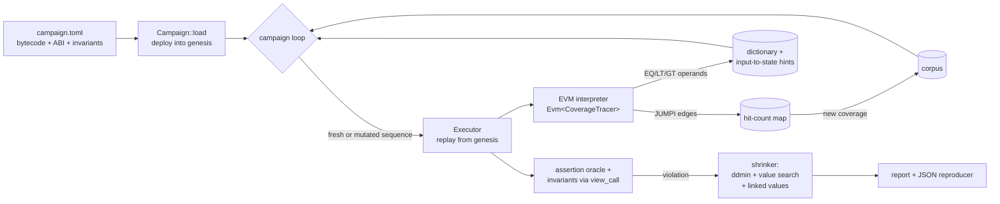

# evmfuzz

A Shanghai-level **EVM interpreter** written from scratch in Rust, and a
**coverage-guided, stateful invariant fuzzer** built on it. You declare
properties such as *"totalSupply equals the sum of all balances"*; evmfuzz
searches for a sequence of transactions that breaks one, then shrinks it to a
minimal reproducer.

```text
  BROKEN  payout-capped  after 2,658 tx / 509 sequences (7.2 ms)
    property: Staged.paidOut() <= Staged.cap()
    failure:  lhs = 120, rhs = 100 (expected lhs <= rhs)
    shrunk 10 -> 5 call(s) in 71 executions:
      1. actor0 -> Staged.unlock1(42)  => ok (gas 43829)
      2. actor0 -> Staged.unlock2(1001)  => ok (gas 26651)
      3. actor0 -> Staged.unlock3()  => ok (gas 26538)
      4. actor0 -> Staged.payout()  => ok (gas 47668)
      5. actor0 -> Staged.payout()  => ok (gas 30568)
```

*(from `make demo`; the fixture only pays out after `unlock1(42)`,
`unlock2(y)` with 1000 < y < 1010, and `unlock3()` from the same sender.)*

## Who it is for

* Smart-contract developers and auditors who want property-based testing of
  compiled contracts without a node, a chain fork or a framework.
* People who want to read how an EVM, a coverage-guided fuzzer, a
  comparison-feedback dictionary and a delta-debugging shrinker fit together.
  Each part is a few hundred lines in its own module, and all of it is tested.

It is a portfolio/educational project, not a replacement for Echidna, Medusa or
Foundry's invariant tester (see [Limitations](#limitations)).

## What is inside

| part | what it does |
|---|---|
| `src/u256.rs`, `src/crypto.rs`, `src/rlp.rs`, `src/trie.rs` | 256-bit EVM arithmetic, in-tree Keccak-256, RLP, Merkle-Patricia state root |
| `src/evm/` | interpreter: all Shanghai opcodes incl. `PUSH0`; gas incl. memory expansion, EIP-2929 warm/cold, EIP-2200/3529 `SSTORE` refunds, 63/64 rule, EIP-3860 initcode; journaled state with O(changes) reverts; `CALL`/`CALLCODE`/`DELEGATECALL`/`STATICCALL`/`CREATE`/`CREATE2` between in-memory contracts; logs; `REVERT`; `SELFDESTRUCT`; transaction validation, EIP-1559 fees, refunds, EIP-161 cleanup; precompiles 0x01 (input checks), 0x02–0x04 |
| `src/statetest.rs` | runner for `ethereum/tests` GeneralStateTests (state root + logs hash) |
| `src/abi.rs` | Solidity ABI: types, selectors, head/tail encoding, JSON ABI loading, revert decoding |
| `src/fuzz/` | campaign loader, invariant language, executor, coverage map, mutator with dictionary + input-to-state hints, shrinker, reports |
| `src/eval.rs`, `src/bench.rs` | ablation harness and throughput benchmarks |
| `fixtures/` | five Solidity contracts with planted bugs plus one bug-free control; bytecode compiled by a pinned solc 0.8.24 and committed |

## Architecture



Every sequence starts from the same genesis state. After each transaction the
executor folds branch coverage into an AFL-style map, records comparison
operands, checks the assertion oracle, and, if the transaction succeeded,
evaluates the invariants with read-only calls that are rolled back afterwards.
Sequences that reach new coverage are kept and mutated further. More detail,
including the algorithms and their complexity, is in
[`docs/ARCHITECTURE.md`](docs/ARCHITECTURE.md).

## Quickstart

Requires Rust ≥ 1.82. No Solidity compiler, node or network is needed.

```bash
make check          # fmt + clippy (-D warnings) + type-check + tests + coverage >= 80%
make demo           # offline end-to-end run over the bundled fixtures
cargo build --release
target/release/evmfuzz fuzz fixtures/vault/campaign.toml --seed 1 --max-tx 100000 --save-dir out
target/release/evmfuzz replay fixtures/vault/campaign.toml out/vault-solvency.json
target/release/evmfuzz statetest tests/ethtests/GeneralStateTests
target/release/evmfuzz run 0x60026003015f5260205ff3 --trace 20
target/release/evmfuzz disasm @fixtures/staged/Staged.bin
```

`fuzz` exits 0 when every property held, 1 when one broke (like Echidna and
Foundry), and 2 on usage errors. `replay` exits 0 when the reproducer still
breaks its property.

### Writing a campaign

```toml
name = "amm"

[actors]
count = 2                      # senders 0x10000, 0x20000; 100 ether each by default

[[contracts]]
name = "Pool"
bytecode = "Pool.bin"          # creation code (hex)
abi = "Pool.abi.json"          # every nonpayable/payable function becomes a target
# args = ["1000000"]           # constructor args; `actorN` / contract names work for addresses

[[aliases]]                    # name contracts created by other contracts
name = "TokenB"
expr = "Pool.tokenB()"

[[invariants]]
name = "reserve-b-backed"
expr = "Pool.reserveB() == TokenB.balanceOf(Pool)"
```

Invariant expressions support view calls on any address-valued expression,
`balance(x)`, `storage(x, slot)`, `address(x)`, `uint(x)`, `sum/all/any(v in
actors|contracts|accounts, expr)`, checked `+ - * / %`, comparisons, `&& || !`,
and `wei/gwei/ether` literals. Failures are explained: `all(...)` reports its
first counterexample, a comparison reports both sides. The built-in `assertion`
oracle flags any call that ends in `Panic(0x01)` or `INVALID`.

## Demo output

From `make demo` (`scripts/demo.sh`), on the bundled fixtures with seed 1 and a
100,000-transaction budget. The full run also prints the vault, token, amm and
control campaigns and replays a saved reproducer:

```text
==== 1. interpreter conformance: pinned ethereum/tests subset (Shanghai) ====
TOTAL                                                   2347       0           54             35

campaign `registry`  seed=1 budget=100,000 tx  coverage=on dictionary=on

  BROKEN  assertion  after 5,305 tx / 900 sequences (15.3 ms)
    property: no call fails an assert() (Panic 0x01 or INVALID)
    failure:  revert: Panic(0x01: assert failed)
    shrunk 7 -> 2 call(s) in 92 executions:
      1. actor0 -> Registry.configure(0)  => ok (gas 43733)
      2. actor0 -> Registry.store(0, 2147483648)  => revert: Panic(0x01: assert failed) (gas 46352)

campaign `vault`  seed=1 budget=100,000 tx  coverage=on dictionary=on

  BROKEN  solvency  after 115 tx / 22 sequences (0.8 ms)
    property: balance(Vault) >= Vault.totalDeposits()
    failure:  lhs = 0, rhs = 2 (expected lhs >= rhs)
    shrunk 9 -> 3 call(s) in 157 executions:
      1. actor0 -> Vault.deposit() {value: 1}  => ok (gas 65723)
      2. actor1 -> Vault.deposit() {value: 1}  => ok (gas 48623)
      3. actor0 -> Vault.emergencyExit(6840335473037917935)  => ok (gas 30887)

  HOLDS   deposits-add-up  (not falsified within budget)
  HOLDS   assertion  (not falsified within budget)

campaign `token-fixed`  seed=1 budget=100,000 tx  coverage=on dictionary=on

  HOLDS   supply-conservation  (not falsified within budget)
  HOLDS   no-balance-above-supply  (not falsified within budget)
  HOLDS   assertion  (not falsified within budget)
```

`6840335473037917935` is `0x5eedc0defeedbeef`, the vault's 64-bit backdoor
code. Random guessing hits it with probability 2⁻⁶⁴ per call; the
comparison-operand dictionary reads it out of the `EQ` instruction. The shrinker
moved the registry's id from the value it was found with to `0` in both calls
together, because the two calls only fail while their ids match.

## Results

### Interpreter conformance

```bash
evmfuzz statetest tests/ethtests/GeneralStateTests     # or: make test
```

| | cases |
|---|---:|
| pass (state root and logs hash match) | **2,347** |
| fail | **0** |
| unsupported (reach precompiles 0x05–0x09 or a valid-signature ECRECOVER) | 54 |
| tests with no Shanghai entry | 35 |

The pinned subset is 26 complete suites (562 files) from `ethereum/tests` v13.3,
including all `GeneralStateTests/VMTests`. See [`DATA.md`](DATA.md) for the list
and for what was left out.

### Planted-bug discovery and ablations (held-out seeds)

```bash
make eval     # = evmfuzz eval <5 fixtures> --seeds 1001..=1030 --max-tx 100000 --jobs 3
```

Fuzzer parameters were tuned on seeds 1–10 only. These are seeds 1001–1030,
30 runs per cell, with a budget of **100,000 transactions** per run (the
documented budget). "median/max tx" is the number of fuzzing transactions
executed when the violation was first seen.

| fixture (planted bug) | property | full | no-dict | no-cov | random |
|---|---|---|---|---|---|
| token (self-transfer mints) | supply-conservation | **30/30**, median 218, max 1,718 | 30/30, 1,020 / 11,323 | 30/30, 144 / 400 | 30/30, 154 / 1,758 |
| vault (64-bit magic backdoor) | solvency | **30/30**, median 1,142, max 9,294 | 0/30 | 30/30, 680 / 11,650 | 0/30 |
| staged (4-stage state machine) | payout-capped | **30/30**, median 4,457, max 27,993 | 2/30 | 3/30 | 0/30 |
| registry (packed codec, `assert`) | assertion | **30/30**, median 1,463, max 11,191 | 30/30, 613 / 4,262 | 30/30, 1,727 / 25,301 | 30/30, 252 / 2,898 |
| amm (cross-contract reserve desync) | reserve-b-backed | **30/30**, median 2,726, max 19,300 | 29/30, 10,427 / 98,920 | 30/30, 5,663 / 27,833 | 6/30, 47,714 / 81,869 |

Modes: **full** = coverage-guided corpus + value feedback (dictionary,
comparison neighbours, input-to-state hints); **no-dict** turns all value
feedback off; **no-cov** turns the corpus off (fresh random sequences, value
feedback on); **random** turns both off. Every property that should hold
(`deposits-add-up`, `reserve-a-backed`, `shares-add-up`, and the `assertion`
oracle where nothing asserts) held in all 600 runs. The bug-free `token-fixed`
control reports nothing (`make demo`, `tests/fixtures.rs`).

How to read this:

* Value feedback carries the vault (a 64-bit equality) and is required for
  `staged` (a narrow range check). Coverage guidance is what makes `staged`
  reliable: the corpus keeps each stage's prefix, so the fuzzer does not have to
  rediscover four ordered calls by chance.
* On shallow bugs (`token`, `registry`) coverage guidance does not help and
  sometimes costs time: plain random sequences already hit them within a few
  hundred transactions, and the corpus spends part of the budget mutating old
  entries. The table shows that rather than hiding it.
* The minimal reproducers are found every time: the median shrunk lengths are
  1, 3, 5, 2 and 4 calls, which are the minimal triggers.

### Throughput

```bash
make bench    # evmfuzz bench <fixtures>, release build, median of 5 runs
```

Measured on an Apple-silicon laptop (macOS, arm64) while other builds were
running, so treat these as rough. An earlier run of the same arithmetic workload
measured 417 Mgas/s, so expect up to about 2x variance between runs.

| interpreter workload | Mgas/s | M instructions/s |
|---|---:|---:|
| arithmetic loop (ADD/MUL/MOD/JUMPI) | 771 | 218 |
| keccak256 of 64 bytes per iteration | 268 | 45 |
| SSTORE/SLOAD over 16 slots | 1,406 | 100 |
| STATICCALL to a tiny contract | 1,046 | 130 |

| fuzzing executions (tx/s) | invariants off | invariants checked |
|---|---:|---:|
| token-fixed | 312,447 | 89,574 |
| vault | 401,465 | 184,787 |
| staged | 454,353 | 446,713 |
| registry | 349,837 | 349,016 |
| amm | 218,443 | 118,077 |

"Executions" are full transactions (validation, execution, coverage and
comparison logging, end-of-transaction cleanup) on random sequences replayed
from genesis. Invariant evaluation dominates when an invariant calls many views:
`token-fixed`'s two invariants make 16 view calls after every successful
transaction. The fuzzer is single-threaded per campaign; `eval` runs campaigns
in parallel.

### Code size and coverage

```bash
scripts/loc.sh       # 7,952 non-blank source lines (excl. inline unit tests), 1,153 unit-test lines,
                     # 750 integration-test lines, 284 lines of Solidity fixtures
make cov             # cargo llvm-cov: 93.3% line coverage over the whole crate (CLI included)
```

## Design decisions

The full log with costs is in [`DECISIONS.md`](DECISIONS.md). The main ones:

* **From scratch, generic over a tracer.** Owning the interpreter lets
  `Evm<NoopTracer>` compile the hooks away while `Evm<CoverageTracer>` sees every
  `JUMPI` and comparison.
* **Journaled state, snapshot genesis.** Reverts cost O(changes) through an undo
  journal. Each fuzzed sequence starts from a clone of the post-deployment world.
* **Invariants as expressions, not contract code.** `sum(a in accounts, …)`
  can only be written from outside the contract. Address arguments are drawn
  from the same account pool, which keeps such sums sound.
* **Three kinds of value feedback.** Pinned bytecode constants, runtime
  comparison operands with ±1 neighbours, and input-to-state hints (the
  Redqueen idea at the ABI level). The last of these took `staged` from a
  ~100k-transaction median to ~3.5k on development seeds.
* **Budget in transactions, not seconds.** `(campaign, seed, budget)`
  reproduces the same findings on any machine, and `tests/fixtures.rs` asserts
  that.
* **Shrinking with linked values.** Plain per-argument shrinking cannot move a
  value that must stay equal across calls. Joint value and sender passes fix
  that.

## Limitations

* **Precompiles.** MODEXP, BN254 add/mul/pairing, BLAKE2F and real ECRECOVER
  signature recovery are not implemented. Their gas is charged, and conformance
  reports those 54 cases as unsupported. A fuzzed contract that calls them
  stops with `UnsupportedPrecompile`.
* **Fork coverage.** Shanghai only. Cancun opcodes (`TLOAD`/`TSTORE`/`MCOPY`/
  `BLOBHASH`/`BLOBBASEFEE`) halt as invalid. There are no system contracts and
  no withdrawals processing.
* **Conformance scope.** 26 of 67 GeneralStateTests suites are pinned. Untested
  suites may hide bugs, especially around precompiles and stress cases.
* **ABI.** No tuples/structs (functions using them are skipped with a warning).
  Address arguments are limited to the campaign's account pool.
* **Fuzzer.** It has no symbolic or SMT component, so arithmetic relations between
  arguments (e.g. `a * 3 == b + 7`) are found only by chance. The assertion
  oracle sees only the top-level call. Sequences replay from genesis, so long
  sequences re-execute their prefixes. Coverage counts `JUMPI` directions only.
* **Evaluation.** The fixtures are small contracts written for this project with
  bugs planted on purpose, so the ablation numbers show how the components
  behave, not how well the fuzzer does on real protocols. "Not falsified within
  budget" is not a proof.
* **Benchmarks** come from one laptop under shared load (see above).
* **CI** (`.github/workflows/ci.yml`) mirrors `make check`/`make demo`, but it
  has not run, because the repository has not been pushed anywhere.

## Roadmap

* Remaining precompiles (MODEXP, BN254, BLAKE2F, secp256k1 recovery) and the
  rest of `GeneralStateTests`.
* Cancun (transient storage, `MCOPY`) behind a fork flag.
* Mid-sequence state snapshots so deep corpus entries are not re-executed.
* Tuple/struct ABI support and arbitrary-address arguments with automatic
  account tracking for `sum` invariants.
* Comparison-distance feedback for narrow numeric ranges, and a parallel
  multi-worker campaign mode.

## Repository layout

```
src/            interpreter, ABI, fuzzer, CLI
tests/          conformance, fixtures, engine, loader, CLI, U256 property tests
tests/ethtests/ pinned ethereum/tests subset + SHA-256 manifest
fixtures/       Solidity sources, compiled bytecode/ABI, campaign files
scripts/        demo, fixture rebuild (pinned solc), test-vector fetch/verify, LOC
docs/           ARCHITECTURE.md, THREAT_MODEL.md
```

License: MIT. `ethereum/tests` data is MIT-licensed by the Ethereum Foundation
(see `DATA.md`).
