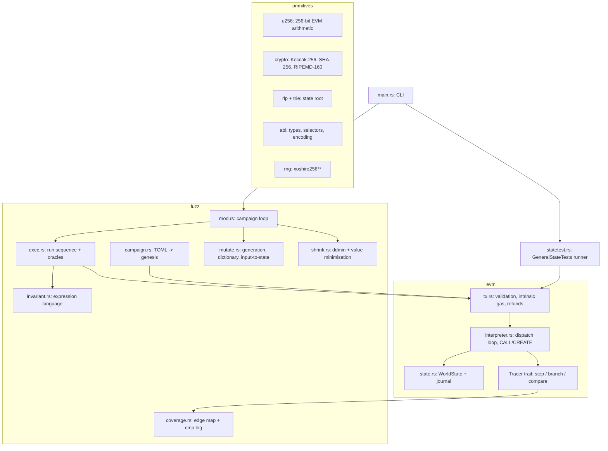

# Architecture

evmfuzz is one Rust crate (library + `evmfuzz` binary) with no runtime
dependencies beyond parsing/CLI crates. Two halves:

1. **`evm`** — a Shanghai interpreter, checked against `ethereum/tests`.
2. **`fuzz`** — a stateful, coverage-guided invariant fuzzer that drives the
   interpreter through call sequences.



## The interpreter (`src/evm`)

**Values.** `U256` stores four little-endian `u64` limbs. Add/sub are carry
chains, multiplication is a truncated schoolbook product (only the low four
limbs are needed for `MUL`), division is Knuth algorithm D, and `MULMOD` divides
a full 512-bit product so it never overflows. Signed ops reinterpret as two's
complement. All of it is property-tested against `num-bigint`
(`tests/u256_props.rs`).

**Frames.** `Evm::call_message` / `create_message` set up a `Frame`
(code, cached jump-destination bitmap, pc, gas, stack, memory, return-data
buffer) and run the dispatch loop `run()`, a single `match` on the opcode byte.
Nested `CALL`/`CREATE` recurse on the native stack; the 1024-frame limit bounds
depth, and long-running work runs on a 256 MiB-stack thread
(`run_with_big_stack`).

**Gas.** Static costs live in the opcode table; dynamic parts follow the
Yellow Paper plus Berlin/London/Shanghai amendments: quadratic memory expansion
(`3w + w²/512`), EIP-2929 warm/cold accounting via a journaled access set,
EIP-2200/3529 `SSTORE` (original/current/new value matrix, 2300-gas sentry,
capped refunds), EIP-150 63/64 call gas, call stipend, new-account surcharge,
EIP-3860 initcode word cost, EIP-170/3541 deployment checks.

**State and reverts.** `WorldState` is a hash map of accounts (cheap to clone,
which is how the fuzzer resets to genesis). `JournaledState` wraps it with the
transaction substate (warm sets, touched set, self-destruct set, logs, refund
counter, original storage values) and an undo journal. A checkpoint is just two
lengths; reverting pops journal entries and applies their inverse, so a revert
costs O(changes since the checkpoint), never O(state). End of transaction applies
self-destructs and EIP-161 empty-account deletion.

**Jump analysis.** Each distinct code hash gets one O(n) pass that marks
`JUMPDEST` positions outside PUSH data in a bitset; results are cached by hash
across frames and sequences.

**Tracing.** `Evm<T: Tracer>` is generic; `NoopTracer` hooks are empty inline
functions that compile away. The fuzzer's `CoverageTracer` implements
`branch` (every `JUMPI`) and `compare` (`EQ/LT/GT/SLT/SGT` operands).

**Conformance.** `statetest.rs` loads filled GeneralStateTests, builds the
pre-state, executes every `post.Shanghai` variant and compares the secure
Merkle-Patricia state root (`trie.rs`, RLP in `rlp.rs`) and `keccak(rlp(logs))`.
Reaching an unimplemented precompile yields `Unsupported` rather than a guess.

## The fuzzer (`src/fuzz`)

### Campaign loading

`Campaign::load` parses the TOML, creates actors (`0x10000`, `0x20000`, …),
deploys each contract with a real creation transaction (constructor args are
ABI-encoded; names like `actor0` or an earlier contract resolve to addresses),
evaluates aliases (e.g. `Pool.tokenA()`), parses and name-checks invariants and
snapshots the result as **genesis**. It also scans deployed runtime code (CBOR
metadata stripped) to count `JUMPI`s for the coverage denominator and to collect
PUSH constants for the dictionary, skipping pushes that feed a `JUMP`/`JUMPI`.

### The campaign loop (`fuzz::fuzz`)

```
while tx < budget and some oracle is still active:
    seq = mutate(pick(corpus)) with p=4/5 if coverage on and corpus non-empty
          else fresh random sequence (1..=max_seq_len calls)
    out = exec.run(seq)             # from genesis, with feedback
    learn(comparison operands, input-to-state hints)
    if out.last_new_coverage = i: corpus.push(seq[..=i])
    if out.violation at step k:
        shrunk = shrink(seq[..=k]); replay with tracing; report; deactivate oracle
```

Corpus picks favour the 8 newest entries half of the time (they tend to sit
deepest in the state machine).

### Execution and oracles (`exec.rs`)

Each call becomes a zero-fee transaction from an actor; the block number
advances by one and the timestamp by the call's warp (12 s by default). After
each transaction:

1. **Coverage commit** — touched map slots are bucketed (AFL counts
   1, 2, 3, 4–7, 8–15, 16–31, 32–127, 128+) and OR-ed into the virgin map; any new
   bit marks the call as interesting. Cost is O(distinct edges touched), not
   O(map size).
2. **Assertion oracle** — top-level `Panic(0x01)` or the `INVALID` opcode.
3. **Invariants** — only after a successful transaction. Each is evaluated with
   `Evm::view_call`, a `STATICCALL` wrapped in checkpoint/revert so warm-set and
   touch side effects disappear, with the tracer disabled so views do not pollute
   coverage.

### Invariant language (`invariant.rs`)

A recursive-descent parser over a small lexer produces an AST; evaluation walks
it with an environment for quantifier variables. Calls infer argument ABI types
from value kinds (`address`, `bool`, `uint256`). Arithmetic is checked. Failed
comparisons are explained with both operand values; failed `all(...)` reports
the first counterexample. Cost: O(nodes × |set|) view calls per evaluation.

### Value generation (`mutate.rs`)

| source | when | what |
|---|---|---|
| input-to-state | 1/3 of argument draws when hints exist | values that were compared against *this argument of this function* (and ±1) |
| dictionary | 40% of integer draws | pinned bytecode constants (never evicted) or recent comparison operands (ring of 1024, ±1 neighbours) |
| interesting | 25% | 0, small, max, max−k, 2^k, 2^k−1, 10^k, 2^(n−1) for the type width |
| random | rest | uniform bit length, then uniform value |

Comparison operands equal to a calldata word of the same call are the fuzzer's
own inputs echoed back and are not added to the dictionary; instead, when one
operand equals argument word *w*, the other operand becomes an input-to-state
hint for *w* — the Redqueen idea (Aschermann et al., NDSS 2019) applied at the
ABI level.

Sequence mutations (1–4 per child): mutate an argument (±delta, bit flip,
regenerate, or input-to-state), change sender, change value/warp, insert, append
(×2 weight), delete, duplicate, swap, splice with another corpus entry.

### Shrinking (`shrink.rs`)

A candidate is accepted iff replaying it from genesis still violates the same
oracle; accepted candidates are re-truncated at their new violation step. Passes
repeat (≤ 8 rounds, ≤ `shrink_budget` executions):

1. **Chunk removal** (ddmin complement): chunk sizes n/2, n/4, …, 1.
   Worst case O(n log n) executions per round.
2. **Per-call simplification**: lowest sender, default warp, value and every
   integer argument minimised by trying 0, 1, then binary search on [1, v]
   (≤ 256 executions for a 256-bit value; monotonicity assumed, a non-monotone
   property simply keeps the current value), earlier pool addresses, `false`,
   shorter byte strings and arrays.
3. **Linked values**: every integer that occurs in two or more arguments is
   minimised *jointly*, and each sender is merged into lower-indexed senders —
   needed for dependencies such as `configure(id)` … `store(id, …)` or
   "the opener must call unlock3".

## Complexity summary

| operation | cost |
|---|---|
| opcode dispatch | O(1) + U256 op (O(1) on 4 limbs; div/mod O(1) with fixed limb count) |
| memory expansion | amortised O(bytes added) |
| checkpoint / revert | O(1) / O(journal entries since checkpoint) |
| jump analysis | O(code) once per code hash |
| state root (conformance only) | O(state size · log) trie build |
| genesis reset per sequence | O(accounts + storage slots) clone |
| coverage commit | O(distinct edges in the transaction) |
| invariant check | O(AST × |set|) view calls |
| shrink | O(n log n) removal + O(args × 256) value search per round, capped by budget |

## Determinism

The only randomness is `Rng` (xoshiro256** seeded through SplitMix64); hash-map
iteration never influences decisions (the corpus and dictionary are vectors);
the budget is counted in transactions. A `(campaign, seed, budget, config)`
tuple therefore reproduces the same findings on any machine — the eval harness
relies on this, and `tests/fixtures.rs` asserts it.
